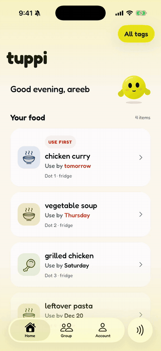

# Hey, I'm Parth 👋

Student builder. Co-founder of **Tuppi**, a food-waste venture built through
IncubatorEDU, where I design and ship the mobile app end to end.

## 🟡 Featured: Tuppi

<table>
<tr>
<td width="330" align="center">

</td>
<td valign="top">

### [Tuppi — know what to eat first](https://github.com/areebhirani-beep/tuppiAPP)

Stick an NFC **dot** on a food container, tap it with your phone, snap a
photo — Tuppi names the dish, maps it to USDA storage guidance, and counts
down so nothing goes to waste.

- 🏷️ The NFC tag **is** the deep link — one route serves taps, links, and typed codes
- 📸 Photo → dish recognition, with credentials kept server-side
- ⏳ Freshness countdowns from USDA FoodKeeper data, fully offline
- 🧑‍🤝‍🧑 A shared fridge for housemates, drawn as an actual fridge
- ✅ 500+ jest tests, strict TypeScript, lint + tests in CI

**[→ Explore the code](https://github.com/areebhirani-beep/tuppiAPP)**

</td>
</tr>
</table>

## 🛠 What I work with

<!--
More projects to feature when they go public:
- stackd
- RotLeague
- CollegeEvalAI
-->
